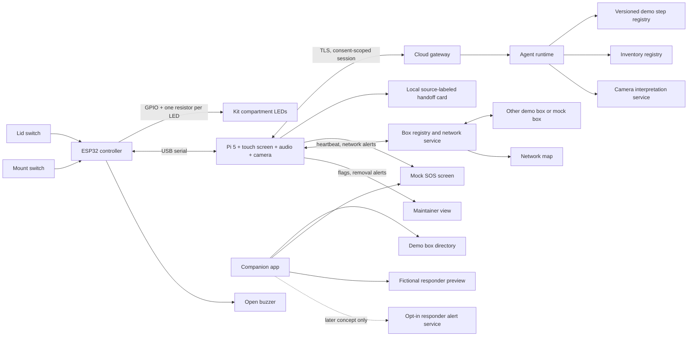

# System architecture — proposal v0.1

**Status:** design only. Scope assumption: one US English fictional adult scenario at a time, with consenting volunteers and no patient use. See [contracts](contracts.md) for messages and [demo content boundaries](medical-safety.md).

## Boundaries and ownership

| Component | Owns | Must not own |
| --- | --- | --- |
| ESP32-WROOM-32 controller board | Lid switch, proposed mount-removal switch and open buzzer, USB serial events, and proposed low-current compartment LEDs through one series resistor per GPIO; optional watchdog/status later | Generative AI, video analysis, emergency call completion, deciding whether an open is theft |
| Screen compute (prototype: Pi 5) | Touch, mic, speaker, movable camera, cached guide, accessibility, mock SOS, local handoff card, box heartbeat, nearby-box alert screen, open snapshot store and return timer | Demo content authoring |
| Box registry and network service | Box site, verified location and directions, last status and last-seen time; fan-out of nearby box alerts after Mock SOS; network map | Contacting emergency services or people, claiming anyone is coming, receiving health data or media |
| Maintainer view | Box status, restock needs, non-emergency open flags with snapshot, mount-removal alerts | Session transcripts, camera frames from guidance, sensor readings |
| Cloud gateway | Device/session auth, rate limits, event routing, consent checks | Deciding care from raw model output alone |
| Agent runtime | Realtime turn handling, tool orchestration, state, interruptions | Inventing steps or sensor values |
| Demo content service | Versioned source-linked scenario bundles and allowed transitions | Free-form medical advice |
| Inventory service | Signed per-box manifest, slot map, expiration and restock status | Claiming an unchecked item is present |
| Companion app | Demo box directory, mock SOS and fictional responder preview | Real emergency calling or dispatch |
| Responder alert service (later concept) | Opt-in/credential checks, nearby matching, invitation lifecycle and incident expiry | Claiming EMS was contacted or a volunteer arrived without confirmation |

## Boot and session

1. Normally closed lid switch changes state on opening. Debounce in hardware and firmware; controller wakes and records `lid.opened` with monotonic time.
2. The Pi is already running in idle mode. The controller sends `lid.opened` over USB serial; the Pi reveals the local Clara Demo screen and mock SOS. USB alone cannot start a powered-off Pi. In parallel and without blocking the screen, the Pi starts the open chime (`alarm.set.request`), stores one local open snapshot, and reports `in_use` in its heartbeat. See [anti-theft](subsystems/anti-theft.md).
3. Screen loads its cached scenario bundle and kit manifest before optional network negotiation. It displays version and stale/unverified inventory status internally; it never promises a supply from an unknown manifest.
4. If user starts an agent session, screen requests audio consent, opens authenticated transport, and sends capabilities, protocol and manifest hashes. Camera, location, and health readings need separate consent/use events.
5. Cloud acknowledges session or screen remains in local guide mode. Every generated step references a demo step ID and matching visual asset version.

## Data flow and trust

- Lid and power events: controller → screen; no health data required.
- Audio: microphone → local VAD/streaming codec → cloud speech/agent only after consent. Transcript is provisional until finalized.
- Camera: user aims camera and explicitly captures a frame; screen shows preview and disclosure; cloud returns observations with uncertainty. No continuous passive video in v0.1.
- Optional GPS: selected GT-U7 receiver → Pi USB serial → fresh, accuracy-marked observation after location consent. A verified site address/floor remains the primary box location, especially indoors; no fix means no inferred coordinates.
- Sensor: adapter → typed reading with device ID, units, measurement time, quality, provenance → screen/agent. Missing or stale values never become zero or an estimate.
- Guidance: demo step registry → versioned bundle → screen cache; agent selects step IDs; screen renders matching text/visual and audio script.
- Inventory: restocker scans sealed kit version and verifies slot contents; runtime reads a snapshot with revision and verification date. Item retrieval points to a slot ID, never model guessed coordinates. The Pi maps a verified slot to a checked physical LED channel and commands the ESP32 over USB; the cloud does not choose a GPIO.
- SOS: the Pi and companion app show the same mock interaction. The app may preview fictional, CPR-trained nearby volunteers; no call, push or emergency message is sent. A later real alert service would operate independently of the agent and in parallel with emergency contact. See [emergency workflow](subsystems/emergency-workflow.md).
- Box network: each Pi sends `box.status` heartbeats with a manifest-based supply summary and no health data. When a box reports `mock_opened`, the network service sends `network.alert` to the other boxes at the same site. The alert has the site, originating box, pre-written directions, a coarse need category and time; no transcript, image, reading or handoff card. A **Bringing this kit** tap returns as `network.alert.ack` and is shown as unconfirmed. See [box network](subsystems/box-network.md).
- Anti-theft: the open snapshot stays on the Pi, encrypted, for the maintainer only, and is deleted after a short retention unless flagged. Mount-removal events and non-emergency open flags go to the maintainer view as `security.flag`. None of this enters the agent or the handoff card.
- Handoff: on request, the Pi builds a source-labeled summary from current-session events for someone who arrives. The agent may draft it, but deterministic validation blocks unsupported facts. Later remote sharing is restricted to an accepted, authenticated SOS recipient after authorization and expiry checks.

## Connectivity modes

| Mode | Available | Missing or changed |
| --- | --- | --- |
| Local only | Mock SOS, fictional site and responder preview, factual handoff card, cached demo guide, inventory map, text/visual steps, pre-recorded audio, replay, verified compartment highlighting when LED hardware works, open chime, local open snapshot, mount-removal return prompt | Cloud conversation, speech understanding, image interpretation, remote telemetry, nearby box alerts, nearest-kit lookup, maintainer alerts; show offline state and "nearby boxes not notified" |
| Slow/intermittent | Same local functions; upload only consented bounded events with idempotency | No waiting for cloud before urgent local actions; expired cloud request is canceled |
| Connected | Optional streaming agent, consented single-frame interpretation, verified directory sync | Still subject to protocol and safety gates |

The demo has no emergency calling hardware or software path. Its mock SOS remains local and clearly shows that no help was contacted. Patient use or public deployment is outside this project.

## Failure behavior

| Failure | Safe behavior |
| --- | --- |
| MCU fails or lid event lost | Manual power and visible demo identification; controller watchdog and boot self-test |
| Pi fails or battery empty | Permanent label identifies a nonfunctional demo box; service alert from last heartbeat |
| Internet drops mid-turn | Stop cloud speech, cancel in-flight tools, keep current step visible, offer cached guide and mock SOS |
| Responder matching or push fails (later concept) | Keep emergency contact path visible; report alert unconfirmed, never imply a volunteer was notified or is arriving |
| Agent handoff draft fails or contains unsupported facts | Show a deterministic card from permitted local events; omit unsupported details, keep mock SOS available |
| Bundle signature/hash invalid | Quarantine bundle, show no affected guided steps, keep mock SOS |
| Inventory stale or item absent | Say availability is unverified; direct user to visually check slot; never claim item exists |
| LED driver, mapping, or USB command fails | Clear any stale light; retain the printed slot label and screen diagram without claiming the LED is lit |
| Camera uncertain | State what was observed and uncertainty; ask a focused question or show a demo guide |
| Sensor error/stale | Display `unavailable`/time and provenance; do not infer a value |
| Conflicting speech or user interruption | Stop agent audio promptly; user control takes precedence |
| Duplicate/out-of-order event | Reject stale sequence or idempotently replay prior result; never double-trigger SOS or send a second nearby box alert |
| Network alert fails or is late | Box A keeps its guide and Mock SOS and says nearby boxes were not notified; never shows "sent" without delivery evidence |
| Box heartbeat stale | Map shows `offline` with last-seen time; the box is never suggested as the nearest kit |
| Receiving box already in a session | Show the alert as a banner; never take over that box's guide or Mock SOS |
| Buzzer, snapshot or mount switch fails | Continue the open flow normally; record a maintenance fault without health data |
| Box removed from its mount | Keep guidance and Mock SOS running; during a session ask for return and start the timer, otherwise alert the maintainer |

## Deployment topology assumptions

The HackPrinceton prototype uses a Pi 5, classic ESP32-WROOM-32 USB-C development board, HDMI/USB touch display, local Wi-Fi, and a warm cloud service. The Pi stays running with its display idle while closed; the ESP32 reports lid changes by USB serial. Battery runtime and lid-to-ready time must be measured. This USB-only connection does not wake a shut-down Pi. See the [linked parts and power notes](prototype-parts.md). The diagram is logical and is **not** a finalized electrical design.
