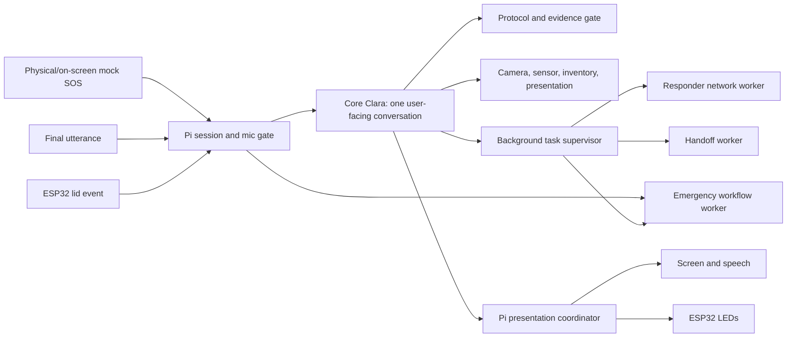

# Conversation and presentation runtime

**Status:** proposed agent architecture with a limited presentation surface implemented. The current demo handles one voice turn at a time and can render answer, question, inventory-item, and preauthored-guidance cards through `screen-view/1.2`; inventory lights and mock SOS also exist. It does **not** implement a persistent cloud agent, generated diagrams, sensor reading cards, camera tools, or background agents. Clara is a proof of concept for fictional scenarios; no real emergency call is placed.

## The interaction

The Pi stays powered. A closed lid means the microphone is stopped and no conversation is available. Opening the lid starts a local session, enables listening, and shows an idle screen. **Opening the lid is not a model request.** A final spoken utterance, an explicit SOS press, or a relevant device event starts work. Silence produces no cloud turns. The user speaks only to **Core Clara**, which maintains one continuous conversation for the open session. The screen displays information when it helps: a diagram, an item location, a reading with provenance, a short answer, a question, a handoff summary, or a versioned guidance panel. It has no Next, Back, Repeat, Talk, or branch buttons. A large simulated SOS control is available even with the lid closed, without login or network.

The current demo's scenario engine is a constrained content adapter, not the definition of the agent. Its `ScreenView.presentation` is an additive local snapshot field: answer/question text, item lookup, and versioned guidance can populate it now. A future presentation service must add validated assets, reading provenance, and synchronized speech segments while retaining source-linked guidance packages and inventory checks. Do not turn an arbitrary model sentence into medical instruction or a purported reading.



## Core event loop and state

1. The Pi accepts a debounced lid event and opens a session without invoking the model. The microphone starts only while open. Closing the lid cancels active turns and listening; locally started mock SOS has its own explicit cancellation rules.
2. VAD finalizes a user utterance and assigns `turn_id`, `session_id`, and a monotonic `input_seq`. The Pi plays a brief capture cue and sends the transcript/audio under session consent. Partials may prepare work, but never trigger an action.
3. Core Clara loads the last 12 concise turns, a durable session summary, current presentation ID, tool observations with timestamps, consent grants, verified kit revision, and active task statuses. Older raw media is not part of long-term context.
4. Core Clara chooses the minimum needed action: answer briefly, ask one focused question, inspect a consented frame, read connected hardware, locate an item, show a source-linked visual, or request mock SOS. A reported emergency can request mock SOS immediately; it never waits for camera or sensor work.
5. A tool dispatcher validates the typed request and deadline. Results return as `ok`, `unavailable`, `stale`, `denied`, `timed_out`, or `cancelled`, with source and observation time. Tool text is untrusted data, never a new instruction. No tool result is silently coerced to a fact.
6. The policy gate checks the response against source-linked guidance, available presentation assets, inventory revision, consent, and emergency state. The Pi commits one `presentation_id` and matching speech segment IDs. A stale turn cannot overwrite a newer visual or light.
7. The Pi renders the visual first, then speaks its matching text. The conversation continues after the display; the person does not have to tap to advance it. The screen may keep useful content visible during silence.

State is per open session: `session_id`, `input_seq`, `active_turn_id`, `conversation_summary`, `recent_turns`, `presentation_id`, `consent`, `kit_revision`, `observations[]`, `tasks[]`, `mock_sos_state`. Persist only the minimum needed for a crash/reconnect and delete it under the retention policy. A worker receives a scoped snapshot, not unrestricted conversation history. It returns facts or status to Core Clara; it never becomes another voice speaking to the user.

## Proposed typed tools

Every call includes `request_id`, `session_id`, `turn_id`, `deadline_at`, and `consent_id` where relevant. Side effects use an idempotency key. Results include `status`, `observed_at`, `source`, and a bounded payload; errors never contain raw media or health data in ordinary logs.

| Tool | Input | Valid result / failure |
| --- | --- | --- |
| `camera.capture` | `purpose`, `consent_id`, `max_age_ms` | One frame reference and capture time; denial/unavailable. `camera.describe` returns **uncertain observations**, never diagnosis. |
| `sensor.read` | `device_id`, `measurement_type`, `max_age_ms` | Fresh wired reading, units, quality, sample time and algorithm version if derived; null/unavailable on failure. No fixtures. |
| `location.current` | `purpose`, `max_age_ms` | Fresh valid GPS coordinates and fix time, or a separately labeled configured-address fallback. The current demo uses this only in local mock SOS coaching; it is not yet a cloud agent tool. |
| `inventory.locate` | `sku`, `manifest_rev` | Verified slot, layout asset ID and LED channel; absent/unverified means no asserted location or light. |
| `presentation.show` | `card_id`, `kind`, `source_ref`, `asset_id?`, `speech_segments[]`, `slot_id?` | Committed presentation ID or rejected. Kinds: `answer`, `question`, `diagram`, `item`, `reading`, `guidance`, `handoff`, `status`. |
| `task.launch` | `kind`, `intent_event_id`, `scope`, `deadline_at`, `idempotency_key` | Task ID and queued/running/finished state; must not claim external delivery. |
| `emergency.mock_sos` | `source`, `idempotency_key` | Local countdown/open/cancel states, explicitly simulated. Real emergency integration is out of scope. |

`presentation.show` is a **proposed** `presentation/1.0` contract, not a deployed wire message. A card has a short title, accessible text, optional approved image, provenance, and optional linked hardware result. Guidance cards require a protocol bundle ID and exact approved text. Reading cards require a valid measurement result ID; item cards require a verified manifest and layout asset. The presenter refuses mismatched references. Its speech and visual text share segment IDs, so highlighting follows the audio actually played. On interruption, playback stops immediately, the active segment is invalidated, and a late render or LED ACK cannot restore it. A caption remains available if audio fails. The base screen reappears when there is no useful card.

## Background agents and authority

The supervisor may run specialized workers while Core Clara keeps talking. Workers are isolated jobs with a typed result, deadline, retry policy, and owner:

| Worker | Trigger | Authority in this demo |
| --- | --- | --- |
| Emergency coordinator | Direct SOS press or explicit user emergency request; urgent reported state can offer/start mock countdown | Local **mock** 911 flow only. No dialing or claim that 911 was reached. |
| Responder coordinator | Mock SOS opened and network available | Uses the existing demo network's actual `sent`, `shown`, `accepted`, `arrived` states. Only confirmed acceptance may produce “is coming.” No assumed delivery. |
| Handoff compiler | User asks for context for someone arriving | Drafts a source-labeled card; deterministic validator checks each fact against events. Remote sharing needs separate consent and a verified recipient. |
| Evidence worker | User asks to look/read, or Core Clara needs one specific missing observation | Calls consented camera or hardware tools and returns uncertainty, provenance and freshness. It cannot select care. |

The coordinator launches a job only from a recorded trigger. Jobs do not repeatedly poll the model during silence. A new user request may cancel a turn without cancelling an already authorized SOS job; the supervisor records this distinction. Closing the lid cancels the conversation and media capture. Direct mock SOS remains available independently of the model, mic, camera, and network. For any future real calling or responder messaging, explicit authorization, integration, delivery verification, legal review, and service testing are unresolved; this design grants no such capability today.

## Timing, disconnects, and examples

Targets, not measured guarantees: local lid-to-listening under 500 ms; end-of-speech after about 700 ms of silence; first spoken/visual response about 3–4 s after speech; tool calls have individual deadlines inside the 8 s box turn budget. A longer task reports a truthful “working” status and completes in the background. If the cloud drops, cancel the in-flight turn and show offline state; keep the last committed visual, local captions, verified item map, and mock SOS. Offline voice understanding and general generation are **not implemented**. Never replay an old turn after reconnect.

```mermaid
sequenceDiagram
  participant U as User
  participant Pi as Pi / screen
  participant C as Core Clara
  participant I as Inventory
  participant P as Presenter
  U->>Pi: Open lid
  Pi-->>U: Idle screen; mic listens
  Note over Pi,C: No model call on lid open
  U->>Pi: “Where is the gauze?”
  Pi->>C: Final utterance, session state
  C->>I: locate(gauze, manifest_rev)
  I-->>C: Verified slot A1 + layout asset
  C->>P: item card + synchronized speech
  P->>Pi: Commit visual, light A1
  Pi-->>U: Shows A1 and says where it is
  U->>Pi: “What does the sensor say?”
  Pi->>C: New turn; cancel older turn if needed
  C->>Pi: sensor.read on connected board
  Pi-->>C: Reading + units + time, or unavailable
  C->>P: Reading card or unavailable status
  P-->>U: Spoken and visual result
```

```mermaid
sequenceDiagram
  participant U as User
  participant Pi as Pi
  participant C as Core Clara
  participant S as Task supervisor
  participant E as Mock emergency worker
  participant R as Responder worker
  U->>Pi: Press SOS or request emergency help
  Pi->>E: Start local mock countdown immediately
  Pi->>C: Record intent and keep conversation open
  E-->>Pi: Mock call open; no real call made
  E->>S: Mock SOS event with idempotency key
  S->>R: Launch responder job if online
  R-->>S: Sent / shown / accepted / failed
  S-->>C: Confirmed status only
  C-->>U: Continues conversation; reports verified status
  Note over Pi,C: A camera or sensor timeout cannot block SOS
```

Example: “Can you see this?” prompts a single-frame consent request. If consent is denied, Clara asks the person to describe it. If a frame is blurry, the screen may show the captured frame with “I cannot tell from this image”; it must not assert an injury. “Show them what happened” produces a handoff card labeled “user reported,” “sensor observed,” and “unknown.” Neither example depends on a fixed step sequence.
