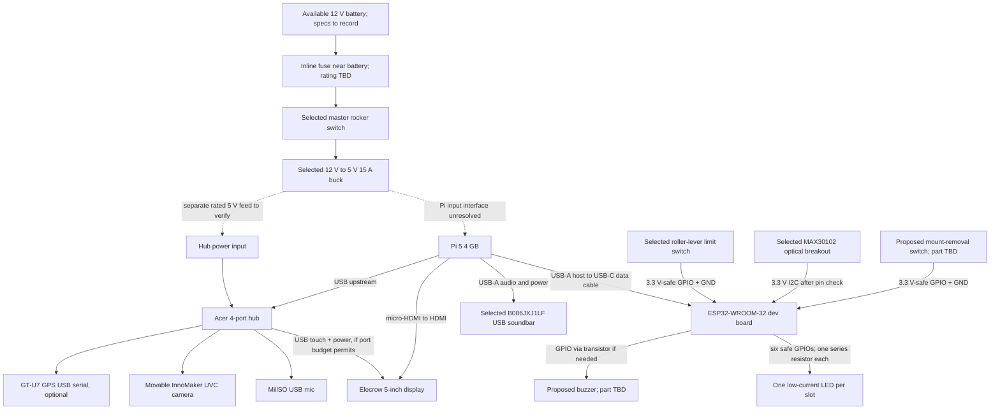

# Hardware and power — HackPrinceton proposal v0.3

**Status:** unbuilt design using the team's [selected Raspberry Pi 5 4 GB kit](https://www.amazon.com/dp/B0FNBYQWX3), [ESP32-WROOM-32 USB-C board](https://www.amazon.com/dp/B0D47J71XZ), and separately available 12 V battery. The Pi stays running while the lid is closed. The ESP32 reports lid events to the Pi through one USB cable. The 12 V battery power interface is **not finalized**; see [selected parts and gaps](prototype-parts.md).

## Compute and wake choice

The Pi is the right computer for USB peripherals, a browser-quality touch UI, local media and streaming cloud transport. The ESP32 is a small switch controller. It does not need to bridge cloud traffic; the Pi connects directly to Wi-Fi. The selected board is **ESP32-WROOM-32**, not ESP32-S3. Espressif's [current WROOM-32 datasheet](https://documentation.espressif.com/esp32-wroom-32_datasheet_en.html) marks that module *not recommended for new designs*, which is acceptable for a short demo but a reason to choose a newer module later.

The Pi 5 does not offer a supported instant suspend-to-RAM wake path; the [Pi power-state specification](https://datasheets.raspberrypi.com/hat/hat-plus-specification.pdf) calls SLEEP untested/unsupported. A halted Pi boots again. **With only a USB cable between boards, an ESP32 cannot wake a powered-off Pi**, and the ESP32 itself loses USB power if the Pi is off. Therefore the HackPrinceton design keeps the Pi running, uses a blank/idle screen while closed, and reveals the Clara Demo UI when a USB serial `lid.opened` arrives. A future battery-optimized design would need a separately powered controller and a Pi power-control connection.

| Option | Lid response | Battery impact | Work |
| --- | --- | --- | --- |
| Pi running + USB ESP32 (**demo choice**) | Fast application wake, measured | Pi draws power the whole time | Simple |
| Pi halted + USB ESP32 | No autonomous wake | Lower standby | Does not meet lid-open behavior |
| Pi halted + separately powered ESP32 + power-button circuit | Cold boot after switch | Lower standby | Additional circuit and boot delay |
| Pi running without ESP32 | Fast direct GPIO event | Similar Pi draw | Fewer boards, but misses intended controller split |

## Actual connection plan

The current ESP32 board communicates through its USB-to-serial bridge at `/dev/cu.SLAB_USBtoUART` on the development Mac; the Pi should discover its stable `/dev/serial/by-id/` path. Use the implemented [serial contract](contracts.md#implemented-pi--esp32-serial-11). There is **no Pi GPIO↔ESP32 UART wire**, no separate 3.3 V regulator for the dev board, and no Pi power-button wire in this demo. Power the screen and hub according to their actual labels, not assumptions based on connector shape.

**Current three-light bench profile:** GPIO33 is the lid input (switch `NC`, `COM` to ground, open when LOW); GPIO21/22 are MAX30102 SDA/SCL; GPIO18/19/23 drive the three installed LEDs, each through its own resistor. The user observed all three bench LEDs lighting. The [integrated firmware](../firmware/README.md) uses this profile over USB serial; six kit slots, a mount switch, a buzzer and their mapping are still proposed.

### Proposed anti-theft inputs and outputs

A second limit switch (or a spare from the same roller-lever pack) on the wall bracket reports when the box is lifted off its mount. Wire it like the lid switch: a safe ESP32 GPIO and ground with pull-up and debounce. A small buzzer gives the open chime. Check the delivered part's current: a low-current 3.3 V active buzzer may run from a GPIO through a resistor, while a louder or 5 V buzzer needs a transistor and must never put 5 V on an ESP32 pin. The flash on open can reuse the compartment LEDs. Neither part is selected yet, and their GPIOs must avoid boot-strapping pins and conflicts with the lid switch, LEDs and MAX30102 I²C. See [anti-theft](subsystems/anti-theft.md). Because the box runs on its internal battery, lifting it off the mount does not cut power; this depends on the unresolved battery path below.

### Proposed compartment lights

For the simplest demo build, use one low-current red or amber LED at each slot, driven by a safe ESP32 output GPIO through **its own series current-limiting resistor**: `GPIO → resistor → LED anode (+); LED cathode (−) → ESP32 GND`. Start with 330 Ω for an ordinary red/amber LED and check current and brightness against the delivered part; a red LED with about 2 V forward drop would draw roughly 4 mA at 3.3 V. [Espressif documents GPIO LED drive](https://docs.espressif.com/projects/arduino-esp32/en/latest/api/gpio.html), and [SparkFun explains series LED resistors](https://learn.sparkfun.com/tutorials/light-emitting-diodes-leds/leds-without-math). Choose six output-capable GPIOs that do not affect boot, the lid switch, USB serial, or MAX30102 I²C. The ESP32's internal pull-up/down is **not** a substitute for the LED's series resistor.

The team's newer [candidate 3 V prewired, 5 mm LED set](https://www.amazon.com/dp/B0B2L9FP4R) includes panel clips, but the listing does not clearly specify a built-in resistor or per-color current. Keep a series resistor until the delivered part is inspected and measured. Its listed 20° beam should be aimed at the slot; test that it is visible with the lid open. The earlier [12 V prewired candidate](https://www.amazon.com/dp/B094YNNCC2) **cannot be driven as intended directly from a 3.3 V GPIO**. Using that part would instead require a switched 12 V branch and an external transistor/MOSFET or [compatible multi-channel driver](https://www.ti.com/product/ULN2803C), plus checking the battery's full voltage range. Neither LED set is in the selected shopping subtotal.

The Pi owns the verified `slot_id → led_channel` map and sends `light.set.request` over the existing USB serial connection. The ESP32 turns on exactly one GPIO output for a bounded lease, then clears it on close, timeout or disconnect. The screen still shows the printed slot label if an LED fails. See [inventory mapping](subsystems/kit-inventory.md) and [wire contract](contracts.md).

## Power budget and unresolved battery interface

The [Pi 5 power documentation](https://www.raspberrypi.com/documentation/computers/raspberry-pi.html) recommends a 5 V, 5 A capable USB-C supply for full USB peripheral power; with a lower-power supply, downstream USB current may be limited to 600 mA. The selected hub's [listing](https://www.amazon.com/dp/B0CN3F9Y1Z) says its separate 5 V USB-C input powers the four USB-A ports. **It does not power the Pi.** The selected [bare-wire USB-C pigtails](https://www.amazon.com/dp/B0GS93KLJ8) are untested: their 5 A label does not prove the Pi recognizes a 5 V/5 A capable source, and exposed wiring adds short/reverse-polarity risk.

The team has a separate 12 V battery and selected a [12 V to 5 V, 15 A converter](https://www.amazon.com/dp/B09X1ZGR38), a [bare-wire USB-C pigtail](https://www.amazon.com/dp/B0GS93KLJ8), XT30 connectors and a master switch. This is a parts selection, **not an approved Pi power circuit**. Record battery chemistry, capacity, connector, built-in protection, charger and voltage range. Put a correctly sized inline fuse close to the battery. Check the switch's DC current rating, converter behavior at startup and full load, polarity, wire/connector temperature, and voltage at the Pi and hub. A pigtail's 5 A label does not establish the Pi's USB-C current signaling. Do not assume the converter includes charging or seamless backup, and do not connect both a wall supply and the converter to the Pi. Measure closed-lid and active watts to estimate runtime from usable battery Wh.

For initial bench bring-up, use a known-good [Pi 27 W USB-C supply](https://www.raspberrypi.com/products/27w-power-supply/) directly on the Pi if one is available. The [hub listing](https://www.amazon.com/dp/B0CN3F9Y1Z) says its 5 V USB-C input powers hub ports only. Its input source and cable must be rated for the measured display, camera, mic and optional GPS load. Check for backfeed when Pi or hub power is removed.

The selected [4 GB kit listing](https://www.amazon.com/dp/B0FNBYQWX3) names the Pi board, case, cooler and screwdriver, **not** a power adapter or microSD card. The team selected a [64 GB Patriot A1 card](https://www.amazon.com/dp/B07FKJS15M). The [Elecrow display package listing](https://www.amazon.com/dp/B0CYKXCM8J) includes cables and a **mini-HDMI** adapter; inspect the delivered leads because Pi 5 uses **micro-HDMI**. Five inches at 800×480 constrains text and diagrams, so prototype the first Clara Demo screen on the exact display.

## Demo checks

1. Bring up Pi from a known 5 V/5 A capable mains supply with cooler; verify display, touch, mic and speaker separately.
2. Connect the ESP32 by USB, read its stable serial identity, wire and debounce the switch, and measure lid-to-visible-screen time over 20 opens.
3. Add the hub and camera/sensor one at a time; record port map and current. Confirm hub external power does not backfeed or leave a device in an unsafe state when the Pi supply is removed.
4. Repeat on the chosen battery, including low-charge behavior. Record closed-lid watts and active watts, estimated and observed runtime, voltage warnings, and whether the display truly blanks its backlight.
5. A printed Clara Demo label remains visible if any electronics fail.
6. If compartment lights are added, verify every physical slot-to-channel mapping and power-on/off state; a wrong or stuck light blocks LED use in the demo.

The selected [MAX30102 breakout](sensor-selection.md) sends raw optical samples over 3.3 V I²C to the ESP32, which relays a live result over its existing USB serial cable. A pulse number requires software signal processing; the breakout does not report one by itself. The optional GT-U7 GPS can use USB serial on the Pi, but the fictional site address remains the primary location because indoor GPS can be unavailable. The demo does not use a canned measurement, and Clara is never used on a patient.
