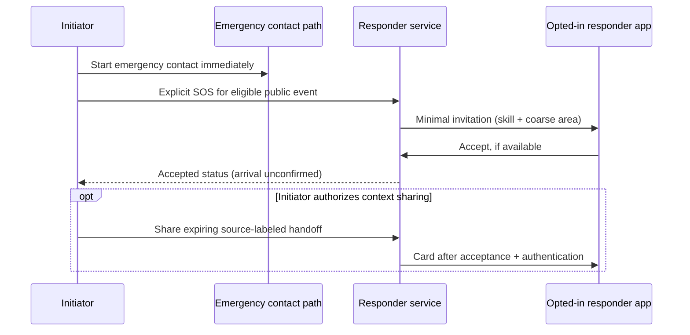

# Mock SOS handoff — proposed demo

The HackPrinceton build uses a **mock SOS**. It shows a fictional site address and a clear simulation state. It never calls 911, sends an emergency message or claims help was dispatched. A direct on-screen control works without the cloud agent, microphone, camera or sensor. The permanent box label identifies Clara as a demo.

When the fictional scenario reaches its SOS moment, the UI opens the same mock screen immediately. The agent may explain what is being shown but does not control whether the local button works. Duplicate taps keep one mock session. A disconnect does not change its state to “sent.” Use `mock_opened` and `mock_failed` in [contracts](../contracts.md); no real call states belong in this demo.

## Nearby trained volunteer concept

The companion app should eventually be able to invite **opted-in, available, nearby volunteers with relevant training** (for example, CPR/AED training) when an eligible SOS occurs. This is a separate, later capability. It must run **in parallel with**, never before or instead of, contacting emergency services. A user can always reach the emergency action without the agent or responder network. [911.gov](https://www.911.gov/calling-911/frequently-asked-questions/) describes the information a caller should give emergency dispatch; [PulsePoint's existing responder program](https://www.pulsepoint.org/pulsepoint-respond) illustrates a dispatch-coordinated, opt-in model for public cardiac-arrest events. Clara has no affiliation or integration with either service.

For a real system, the trigger must come from an explicit human SOS or an authorized dispatch signal, not an agent's camera or sensor guess. Limit CPR/AED alerts to a human-reported or dispatch-confirmed eligible event; do not infer that CPR is needed from a device reading. A responder profile needs notification opt-in, current availability, location-sharing consent, training type, verification status and expiry. Restrict public volunteer alerts to eligible public locations until a jurisdiction and partner approve a broader policy. Do not label a self-reported skill as verified or a volunteer as an official responder.

The alert service would match only the minimum necessary nearby candidates, deduplicate one incident, rate-limit abuse, and expire unanswered invitations. An invitation should reveal a coarse area and requested skill; disclose the exact incident location only after the recipient accepts and the policy allows it. Do not send patient identity, camera frames, health readings or transcripts. Show distinct states for **requested**, **delivered**, **accepted** and **arrived**; never turn a push receipt into “help is coming.” If network, location, push delivery or matching fails, the emergency action continues and the interface says the volunteer request is unavailable or unconfirmed. Cancel/resolve the incident and revoke location access when it ends. A real deployment would need dispatch coordination, identity/training verification, consent, privacy, liability, misuse and false-alarm review before sending any alert.

For HackPrinceton, show only a **mock responder preview** using fictional profiles and a fictional public site. The screen may show “2 fictional CPR-trained volunteers would be eligible” and a simulated accepted state, clearly labeled simulation. It sends no push and must not display real people or claim help is coming.

## Context for someone arriving

The box should offer a **Show handoff** action after Mock SOS and during the fictional guide. It displays a concise card for a person who has just arrived: fictional site/box location, what the user reported, time-stamped camera or sensor observations only if sharing was separately allowed, what versioned demo steps were shown or acknowledged, unresolved questions, and the mock SOS state. The card labels each fact as *reported*, *observed*, or *unknown* and includes its time; it never turns a camera guess into a diagnosis or says a responder was contacted. The agent may draft wording from the session event log, but a validator permits only cited facts and versioned step IDs. If the cloud is down, the Pi assembles the same basic card from local events. The user chooses when to show it; it does not cover the Mock SOS control.

In a later real responder network, the same minimum context could be shared with a specific invited person **after they accept and authenticate**, subject to explicit sharing authority and a short expiry. The first alert contains no patient details and is never delayed while the agent prepares a summary. Separate the incident location, user-reported facts, device observations and actions already taken. Show source/time/uncertainty and allow revocation. Do not include raw audio, images or a transcript by default. If summary generation fails, share no invented details; emergency contact and the responder invitation continue.

```mermaid
sequenceDiagram
  participant U as Box user
  participant UI as Box or companion app
  participant S as Local mock SOS
  participant R as Fictional responder preview
  U->>UI: Tap Mock SOS
  UI->>S: Open immediately (works offline)
  S-->>U: Fictional address + simulation label
  opt Another person arrives
    U->>UI: Show handoff
    UI-->>U: Source-labeled fictional context card
  end
  opt User opens responder preview
    UI->>R: Match seeded fictional profiles
    R-->>UI: Simulated eligible count/status
    UI-->>U: Preview only; no alert sent
  end
```

Later concept, **not a demo data flow**:



Acceptance: the mock action works offline, after a denied camera permission and after a sensor error. The preview uses only seeded fictional responders, requires no real location, and still works if the cloud is unavailable. The handoff card works offline, labels reported versus observed facts, omits unconsented media/measurements, and never claims an unperformed step or a contacted responder. Duplicate taps do not create duplicate previews. The UI remains visibly a simulation throughout. The public AED and disaster setting motivates the concept, but placement and real emergency communications are outside this project.
