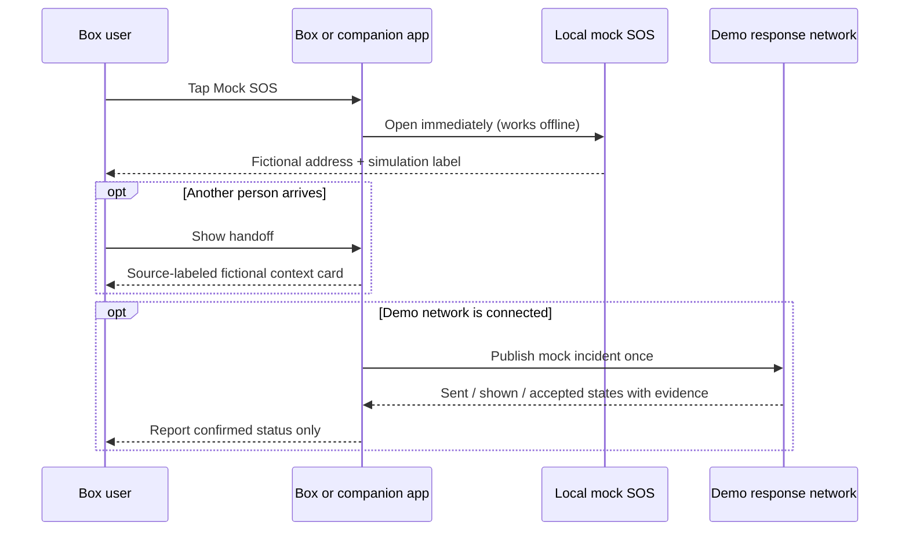
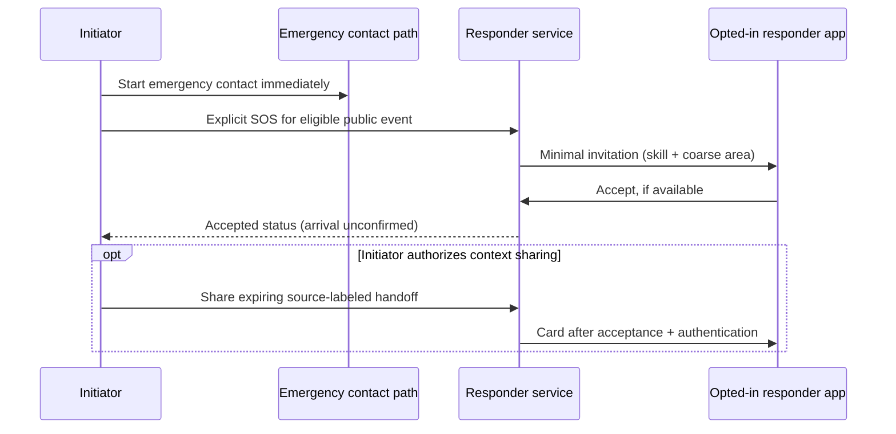

# Mock SOS handoff — proposed demo

The HackPrinceton build uses a **mock SOS**. Its coaching panel shows a fresh, valid GPS fix as measured coordinates with fix time, or `Configured box address: 1455 California Ave` when there is no valid fix. The configured address is not presented as a measured GPS position. The panel remains visibly a simulation; it never calls 911 or claims help was dispatched. A direct on-screen control works without the cloud agent, microphone, camera or sensor. A model-selected `suggest_sos` can also start the **simulated** countdown after a spoken request or reported emergency; the local control remains independent. The permanent box label identifies Clara as a demo. Location from this flow stays on the Pi and screen, not in a cloud or volunteer alert.

When the fictional scenario reaches its SOS moment, the UI opens the same mock screen immediately. The agent may explain what is being shown but does not control whether the local button works. Duplicate taps keep one mock session. A disconnect does not change its state to “sent.” Use `mock_opened` and `mock_failed` in [contracts](../contracts.md); no real call states belong in this demo.

**Demo implemented, physical check pending:** an independent backend mock worker starts when a mock incident opens. It gets the configured public box address or `unavailable` from the Pi; precise GPS stays local. It may request the situation, number of people, or location. The Pi ignores push wording as an instruction and shows/speaks its own fixed prompt through Clara's one screen and speech queue; canonical Cartesia audio is optional. A matching `answer_emergency_question` action sends the exact finalized user words, linked to the preceding `report.heard` event, back to the worker. The user can continue an ordinary conversation while this task runs. The model is instructed to leave unrelated words in the normal conversation; the code validates task IDs and transcript provenance, while semantic answer matching still needs scenario tests. The question expires after 120 s or clears on lid close. The worker reports `collecting_facts`, `facts_ready`, or `cancelled` and **never dials**. See the implemented [events/0.2 and voice-turn/0.3 contracts](../contracts.md).

**Demo implemented in code, phone delivery unverified:** a separate `demo911` adapter may ring a **team-owned demo dispatcher number** through Twilio about four seconds after mock SOS opens. It requires Twilio credentials and `CLARA_DEMO_911_NUMBER`; the target is validated as a full E.164 number, and emergency short codes are refused. Missing configuration produces a `not_configured` log/status rather than a call. One call is attempted per incident. Its TwiML identifies the call as simulated and reads a one-time briefing from the box event log: configured address (labeled as configured, never live GPS), user report, timer-start facts labeled unconfirmed, and responder status known then. The independent fact worker can keep asking questions after that briefing; later answers are **not** included in the phone call. `placed` means Twilio accepted the request, not that the demo phone was answered. Neither path calls 911 or claims a dispatcher was reached.

**Demo implemented in code; physical check pending:** the on-box **Show / Read Summary** control uses fixed templates over this box's own session events and can work offline. It labels bystander speech as reported, guidance as steps shown, and a valid pulse result as a device reading; it does not claim that a treatment happened. When the server opens the mock incident, `incident.opened` supplies a token-backed report URL and a six-character short code. The box displays the short link as text, not a QR code. Unknown or colliding short codes return 404. No link is displayed before the server supplies one or while an offline incident cannot be created. The report is for demo handoff; neither the link nor the local summary indicates that emergency services were reached.

**Draft scenario implemented in code; content and physical review pending:** `not_breathing/draft-1` can open the simulated SOS countdown and show a 110 bpm CPR coach with LED beat, generated audio ticks, fixed spoken reminders, and a screen beat count. The number counts scheduled beats, not observed compressions. A missing pulse result from the connected sensor may ask the bystander to check responsiveness and breathing; it never starts CPR on its own. Only the bystander's answer can take the shortcut into the coached step. The user can stop the coach; scenario change and session close stop it too.

## Independent caller task — future architecture

In a future system with a reviewed 911/dispatch integration, explicit human SOS or authorized dispatch would launch a dedicated caller subagent. **This is proposed, not in the hackathon demo.** The caller starts contact using known, source-labeled session facts and the configured public box address; a fresh GPS fix may leave the Pi only after explicit per-session location-sharing consent. It does not wait for missing answers. Core Clara remains the sole voice talking to the box user and continues other help while the caller works. If the caller needs a detail, it sends a `caller.fact_needed` event tagged with `task_id` and `question_id`. Core Clara asks the reviewed question, then returns only the relevant finalized user reply with those IDs and `source:user_report`. Silence, an unrelated reply, or uncertain transcription never becomes a fabricated answer. If the lid closes, the unanswered question becomes unavailable while the caller continues its authorized attempt. The caller keeps its own status and deadline; a cancelled conversation turn or closed lid does not silently cancel an authorized call. See the proposed [caller-task/0.1 contract](../contracts.md).

The demo's local mock SOS is already independent of the cloud turn, camera and sensor. It never dials. For a future real call, an attempted dial or transport connection is not proof that a dispatcher answered; the user-facing status must come from verified adapter evidence. On network failure the state is unknown until reconciled, and the box must keep a direct human emergency path available. Real cancellation, privacy, telecom reliability, dispatcher integration, and jurisdictional review remain unresolved before any deployment.

## Nearby trained volunteer concept

The companion app should eventually be able to invite **opted-in, available, nearby volunteers with relevant training** (for example, CPR/AED training) when an eligible SOS occurs. This is a separate, later capability. It must run **in parallel with**, never before or instead of, contacting emergency services. A user can always reach the emergency action without the agent or responder network. [911.gov](https://www.911.gov/calling-911/frequently-asked-questions/) describes the information a caller should give emergency dispatch; [PulsePoint's existing responder program](https://www.pulsepoint.org/pulsepoint-respond) illustrates a dispatch-coordinated, opt-in model for public cardiac-arrest events. Clara has no affiliation or integration with either service.

For a real system, the trigger must come from an explicit human SOS or an authorized dispatch signal, not an agent's camera or sensor guess. Limit CPR/AED alerts to a human-reported or dispatch-confirmed eligible event; do not infer that CPR is needed from a device reading. A responder profile needs notification opt-in, current availability, location-sharing consent, training type, verification status and expiry. Restrict public volunteer alerts to eligible public locations until a jurisdiction and partner approve a broader policy. Do not label a self-reported skill as verified or a volunteer as an official responder.

The alert service would match only the minimum necessary nearby candidates, deduplicate one incident, rate-limit abuse, and expire unanswered invitations. An invitation should reveal a coarse area and requested skill; disclose the exact incident location only after the recipient accepts and the policy allows it. Do not send patient identity, camera frames, health readings or transcripts. Show distinct states for **requested**, **delivered**, **accepted** and **arrived**; never turn a push receipt into “help is coming.” If network, location, push delivery or matching fails, the emergency action continues and the interface says the volunteer request is unavailable or unconfirmed. Cancel/resolve the incident and revoke location access when it ends. A real deployment would need dispatch coordination, identity/training verification, consent, privacy, liability, misuse and false-alarm review before sending any alert.

The current **demo response network** can alert enrolled test volunteers through the companion app and can record sent, shown, accepted, and arrived states. The implemented dispatch coordinator can run a deep agent with responder-scout, logistics, and time-to-care subagents when enabled with a model key; its tools are bounded by deterministic checks. It does not speak to the box user or contact 911. It is separate from the proposed caller task. Only a confirmed accept may produce “is coming,” and no notification receipt proves arrival. Wider public responder deployment still needs the program and safeguards above.

## Context for someone arriving

The implemented on-box summary is deliberately narrow: it uses fixed templates over this lid session’s local events, can be shown or read during mock SOS, and includes no camera frames or unconsented measurements. A richer handoff worker that drafts context for a specific arriving person remains **proposed**. It would need source/time labels, separate sharing authority for camera or sensor observations, and validation against the event log. No model-generated handoff or remote sharing is implemented.

In a later real responder network, the same minimum context could be shared with a specific invited person **after they accept and authenticate**, subject to explicit sharing authority and a short expiry. The first alert contains no patient details and is never delayed while the agent prepares a summary. Separate the incident location, user-reported facts, device observations and actions already taken. Show source/time/uncertainty and allow revocation. Do not include raw audio, images or a transcript by default. If summary generation fails, share no invented details; emergency contact and the responder invitation continue.

Later concept, **not a demo data flow**:

Acceptance: the mock action works offline, after a denied camera permission and after a sensor error. A connected demo-network alert is deduplicated and its delivery and acceptance are reported separately; an offline box does not claim a volunteer was notified. A future handoff card must label reported versus observed facts, omit unconsented media/measurements, and never claim an unperformed action or contacted responder. Duplicate taps do not create duplicate mock incidents. The UI remains visibly a simulation throughout. The public AED and disaster setting motivates the concept, but placement and real emergency communications are outside this project.
